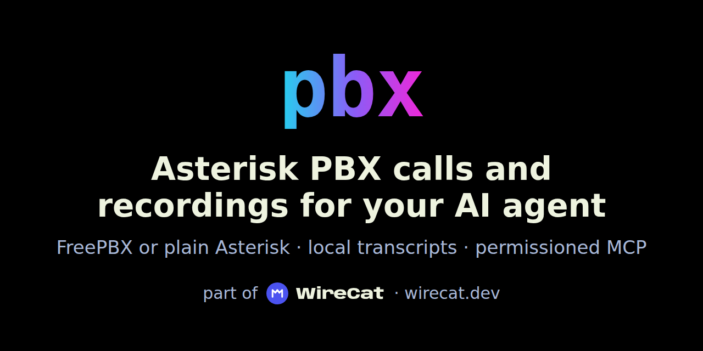

<p align="center">
  
</p>

# pbx — Asterisk PBX calls for AI agents

**Asterisk PBX calls and recordings for your AI agent.** Ask who called about the invoice, what the client was
promised, and which calls nobody answered, from Claude Code, Codex or any MCP client.

Your company's phone calls from an Asterisk PBX (FreePBX, Issabel, VitalPBX or plain Asterisk), with their recordings
transcribed on your computer, searchable offline, and ready for any agent, within limits you set.

[Documentation](docs/index.md) · [Install and connect](docs/installation.md) · [Commands](docs/commands.md) ·
[WireCat](https://wirecat.dev)

[](https://www.npmjs.com/package/@wirecat/asterisk-cli)
[](https://github.com/WireCatLabs/asterisk-cli/actions/workflows/ci.yml)
[](https://nodejs.org/)
[](LICENSE)

<!-- Demo slot: a 30–45 s recording of the exchange below goes here, as an absolute
     raw.githubusercontent.com URL so it also renders on npmjs.com. Invented calls only. -->

`pbx` reads the PBX's call records (CDR) from `Master.csv` or from the CDR database, and copies them into the
local [WireCat](https://wirecat.dev) store: one meeting per call record, with the extension and the outside caller as
its people. It links each call to its recording file. `meetings transcribe` turns the recordings into text with a
speech model that runs on this computer. Then you and your agent list, read and search the calls with no network,
next to the chats, mail and meetings of the other WireCat tools. `pbx` only reads: it never changes the PBX, its
settings or a recording.

An example conversation (invented calls, illustrative output):

```text
You:    Use pbx. What did +7 900 000-00-01 say about the payment on the last call?
Agent:  (runs pbx office meetings list "title:*79000000001*" --json, then pbx office meetings transcript 1 --json)
        On 31 October the client said the invoice will be paid on Friday, after their director signs it.
```

## Quick start

```sh
npm install -g @wirecat/asterisk-cli
pbx office config set cdr_csv_path /var/log/asterisk/cdr-csv/Master.csv
pbx office config set recordings_path /var/spool/asterisk/monitor
pbx office config set cdr_timezone Europe/Moscow
pbx office config set phone_region ru
pbx office session start             # checks the source; asks a password only for a database
pbx office meetings sync             # import the call records and link their recordings
pbx models download gigaam-v3        # the local speech model, once
pbx office meetings transcribe       # transcribe up to 20 recorded calls
```

`office` is a profile: a name you choose for one PBX. It is the first word of every command that uses an account.
The first sync reads 30 days back; `--since-time 2025-01-01T00:00:00Z` reads further. Each later sync reads what is
new, and a repeated sync never makes a call twice.

You need Node.js 22.16 or a later 22.x, or Node.js 24 or later, and `ffmpeg` to transcribe WAV and GSM recordings.
The command is `pbx`, also installed as `wcat-pbx`. It is not `asterisk`, so it never hides the PBX's own program.

More: [install and connect](docs/installation.md) · [use it](docs/usage.md).

## What you can do

**List the calls.** Filter by time, duration or the number in the title.

```sh
pbx office meetings list "started_at>=2026-11-01 duration_ms>=60000"
```

**Read a call.** Who called whom, when, how long, and its recording.

```sh
pbx office meetings show 42
pbx office meetings transcript 42
```

**Transcribe what is new.** Without a query, every call of five seconds or more that has a recording and no
transcript yet, newest first. A recording already transcribed is not read again. A call that fails is listed and the
rest go on.

```sh
pbx office meetings transcribe --max-meetings 50
```

More:

- Find an operator across the calls: `pbx office meetings people "Anna"`.
- Export a call as Markdown or WebVTT: `pbx office meetings export 42 --format vtt --output call.vtt`.
- Ask about one person across calls, chats and mail: `memo context "Ivan Testov"`.

More: [use it](docs/usage.md).

## For AI agents

- **An agent with a terminal** — Claude Code, Codex, Gemini CLI, OpenClaw or Hermes Agent. It runs `pbx` itself.
  `pbx skill install` writes the skill, the agent's instruction sheet.
- **An app with no terminal** — Claude Desktop, Cursor and other MCP clients. Connect the profile's MCP server,
  `pbx office mcp serve`; `pbx office mcp config` prints the entry to paste.

```sh
pbx skill install
pbx office mcp add claude-code --allow-writes   # or: codex
```

`meetings sync` and `meetings transcribe` change the local store, so `mcp add` stops until you pass
`--allow-writes`. The profile's permissions decide what an agent may run. Text from a call — a transcript, a caller
name, a phone number — is marked `untrusted`: it is data for the agent, never instructions. `session start` and
`session end` are never offered to an agent.

## Why this tool

- **Read-only against the PBX.** It opens Master.csv or a read-only database session and reads the recordings. It
  never writes, moves or deletes a file there, and needs no change to the dialplan.
- **The recordings stay with you.** Speech is recognized on this computer. No recording or transcript goes to a speech
  service.
- **A call is one call.** The rows a ring group, a queue or a transfer writes are joined by their `linkedid`, and the
  call says what became of it: who answered after how long, who rang without answering, voicemail, busy or missed.
- **One store with the other WireCat tools.** A caller's number is kept in the international form, as WhatsApp, MAX
  and the CRMs keep it, and a caller on a mobile number joins the CRM contact or chat person with that number.

## Sign-in and profiles

Each profile is one PBX. No command ever picks a profile for you; `pbx session list` lists them.

```sh
pbx office session start             # checks the source, asks a password only for a database
pbx office session status --check    # read the newest call records again
pbx office session end               # forget the password; the imported calls stay
```

A profile on a local or mounted `Master.csv` needs no password. A database profile asks for the password of a
read-only user once, checks it, and keeps it in the system keyring. Where the keyring fails, it uses a private file and
says so once. `PBX_TOKEN` in the environment is read first.

## Settings and permissions

The settings of each source are in [install and connect](docs/installation.md); `pbx office config show` lists
them. Each command has a permission key, its path: `meetings.sync`, `meetings.transcribe`. Each is `allow`, `ask`,
`readonly` or `deny`. `PBX_READ_ONLY=1` refuses every command that changes your sign-in or settings.

More: [settings](docs/configuration.md).

## Limits

- **Call records.** `pbx` reads the call records (CDR) from Master.csv, from MySQL or MariaDB, and from PostgreSQL.
  These are the three places where Asterisk most often keeps its call history. `pbx` does not use CEL, AMI or ARI:
  CEL is a log of each step inside a call, and AMI and ARI are interfaces that control calls while they happen. Call
  history does not need them.
- **Where the files are.** `pbx` reads Master.csv and the recordings on this computer, in a mounted folder, or on the
  phone system over SFTP (secure file access through SSH, the remote login service of the phone system). A profile
  keeps one saved password, so a profile that reads a database connects to SFTP with a key file. `pbx` does not open
  an SSH tunnel (a secure connection) to a database that listens only on the phone system: open it yourself, as
  [install and connect](docs/installation.md#a-cdr-database) shows. A second saved password and a built-in tunnel
  are planned.
- **Who said what.** Every recording is turned into text. A stereo recording in the sound formats MP3, Ogg or FLAC
  keeps its two channels apart: set `recordings_channels`, and each line names the caller or the employee. Without
  that setting, the lines say `Channel 1` and `Channel 2`. A mono recording gives the text without names, and so
  does a WAV or GSM recording, because ffmpeg mixes its channels into one.
- **Size.** Master.csv on this computer or in a mounted folder can be of any size: `pbx` reads it line by line. Over
  SFTP it can be up to 512 MB, because it is read into memory whole. A recording can be up to one hour long, and up
  to 2 GB for WAV, GSM and M4A or 256 MB for MP3, Ogg and FLAC.
- **Speech recognition.** It runs on this computer only. A cloud speech-to-text service is planned, as an option you
  turn on.

More: [what is planned](docs/roadmap.md) · [compared with other tools](docs/compare.md) · [on wirecat.dev](https://wirecat.dev/en/docs/pbx/compare)

## Security

- The store keeps callers' numbers and names, the extensions, and what was said. Treat it like the calls themselves.
- Recording a call and processing it may need the consent of the people on it. That is the PBX owner's duty; see
  [security](docs/security.md#recordings-and-consent).

More: [security](docs/security.md). Report a vulnerability as [SECURITY.md](SECURITY.md) says.

## When it does not work

```sh
pbx doctor                           # what is set up; no network, no keyring
pbx office session status --check    # does the source still answer
pbx office meetings sync --trace     # the connection log, never content
pbx office runs list                 # failed runs are kept
```

More: [when something goes wrong](docs/troubleshooting.md).

## Documentation

| Section | Pages |
|---|---|
| Start | [overview](docs/index.md) · [install and connect](docs/installation.md) · [use it](docs/usage.md) |
| Reference | [all commands](docs/commands.md) · [settings and permissions](docs/configuration.md) |
| If something is wrong | [when something goes wrong](docs/troubleshooting.md) · [security](docs/security.md) |
| Project | [compared with other tools](docs/compare.md) · [roadmap](docs/roadmap.md) · [CHANGELOG.md](CHANGELOG.md) |

For developers: [design](docs/dev/DESIGN.md), [tests](docs/dev/TESTING.md) and the rules for agents in
[AGENTS.md](AGENTS.md).

## Development

```sh
pnpm install
pnpm lint && pnpm typecheck && pnpm test
pnpm build && pnpm smoke:node          # the built command: the bundle users install
pnpm generate                          # rewrite the generated files
pnpm release:check                     # every check CI runs
```

`examples/` holds a made-up Master.csv and two short recordings, for trying the tool without a PBX.

## Part of WireCat

`pbx` is one of the [WireCat](https://wirecat.dev) tools. They share one local store, so a caller found in
`pbx` is the same person in Telegram, MAX, WhatsApp, mail and the CRM, and `memo` answers about them across all
of it. The PBX sibling is beeline-cli, for Beeline's cloud PBX.

## Contributing and license

Pull requests, bug reports and ideas go to [issues](https://github.com/WireCatLabs/asterisk-cli/issues).

Apache License 2.0 — [LICENSE](LICENSE).
