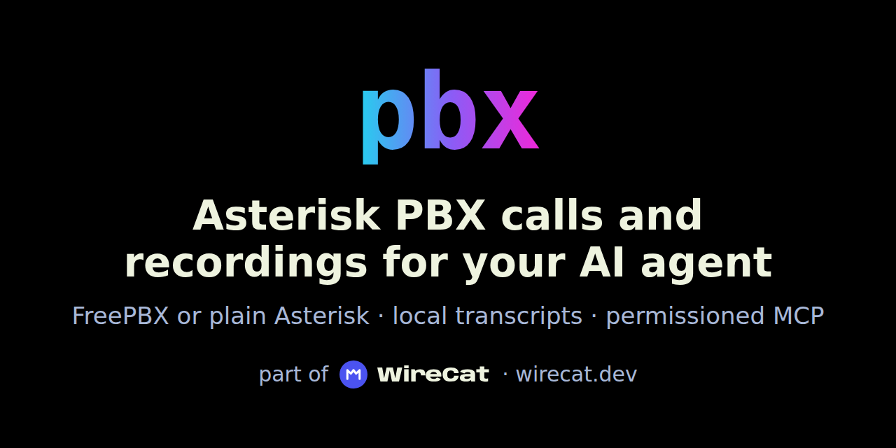

<p align="center">
  
</p>

# pbx — Asterisk PBX calls for AI agents

**Asterisk PBX calls and recordings for your AI agent.** Ask who called about the invoice, what the client was
promised, and which calls nobody answered, from Claude Code, Codex or any MCP client.

Your company's phone calls from an Asterisk PBX (FreePBX, Issabel, VitalPBX or plain Asterisk), with their recordings
transcribed on your computer, counted, searchable by words and by meaning, and ready for any agent, within limits you
set.

[Docs](https://wirecat.dev/en/docs/pbx) ·
[Install](https://github.com/WireCatLabs/asterisk-cli/blob/main/docs/installation.md) ·
[Usage](https://github.com/WireCatLabs/asterisk-cli/blob/main/docs/usage.md) ·
[Discord](https://discord.gg/DebENqbRrJ)

[](https://www.npmjs.com/package/@wirecat/asterisk-cli)
[](https://github.com/WireCatLabs/asterisk-cli/actions/workflows/ci.yml)
[](https://nodejs.org/)
[](LICENSE)

<!-- Demo slot: a 30–45 s recording of the exchange below goes here, as an absolute
     raw.githubusercontent.com URL so it also renders on npmjs.com. Invented calls only. -->

`pbx` reads the PBX's call records (CDR, the call detail records) from `Master.csv` or from the CDR database, and
copies them into the local [WireCat](https://wirecat.dev) store: one meeting per call, with the extension and the
outside caller as its people. It links each call to its recording file. `meetings transcribe` turns the recordings
into text with a speech model that runs on this computer. Then you and your agent count, read, search and mark the
calls with no network, next to the chats, mail and meetings of the other WireCat tools. `pbx` only reads: it never
changes the PBX, its settings or a recording.

An example conversation (invented calls, illustrative output):

```text
You:    Use pbx. What did +7 900 000-00-01 say about the payment on the last call?
Agent:  (runs pbx office meetings list "title:*79000000001*" --json, then pbx office meetings transcript 1 --json)
        On 31 October the client said the invoice will be paid on Friday, after their director signs it.
```

## Quick start

```sh
npm install -g @wirecat/asterisk-cli
pbx office config set cdr_csv_path /var/log/asterisk/cdr-csv/Master.csv
pbx office config set recordings_path /var/spool/asterisk/monitor
pbx office config set cdr_timezone Europe/Moscow
pbx office config set phone_region ru
pbx office session start             # checks the source; asks a password only where one is needed
pbx office meetings sync             # import the call records and link their recordings
pbx models download gigaam-v3        # the local speech model, once
pbx office meetings transcribe       # transcribe up to 20 recorded calls
```

`office` is a profile: a name you choose for one PBX. It is the first word of every command that uses an account.
The first sync reads 30 days back; `--since-time 2025-01-01T00:00:00Z` reads further. Each later sync reads what is
new, and a repeated sync never makes a call twice.

You need Node.js 22.16 or a later 22.x, or Node.js 24 or later, and `ffmpeg` to transcribe WAV and GSM recordings.
The command is `pbx`, also installed as `wcat-pbx`. It is not `asterisk`, so it never hides the PBX's own program.

More: [install and connect](docs/installation.md) · [use it](docs/usage.md).

## What you can do

**List the calls.** Filter by time, duration or the number in the title.

```sh
pbx office meetings list "started_at>=2026-11-01 duration_ms>=60000"
```

**Read a call.** Who called whom, when, how long, and its recording.

```sh
pbx office meetings show 42
pbx office meetings transcript 42
```

**Transcribe what is new.** Without a query, every call of five seconds or more that has a recording and no
transcript yet, newest first. A recording already transcribed is not read again. A call that fails is listed and the
rest go on.

```sh
pbx office meetings transcribe --max-meetings 50
```

**Count the calls.** Calls by direction and outcome, per employee, by hour and by day, and the missed calls with
whether the client was called back.

```sh
pbx office stats calls show --since-time 7d
```

**Search what was said.** By words, or by meaning with a local text model.

```sh
pbx office search meetings "refund"
pbx office search meetings "a client unhappy with the delivery" --model embeddinggemma
```

**Mark calls.** Mark every call the search finds. A second run marks only the new calls.

```sh
pbx office tags add complaint --matching "refund OR complaint"
pbx office tags list tag:complaint
```

More:

- Find an operator across the calls: `pbx office meetings people "Anna"`.
- Export a call as Markdown or WebVTT: `pbx office meetings export 42 --format vtt --output call.vtt`.
- Ask about one person across calls, chats and mail: `memo context "Ivan Testov"`.

More: [use it](docs/usage.md).

## For AI agents

- **An agent with a terminal** — Claude Code, Codex, Gemini CLI, OpenClaw or Hermes Agent. It runs `pbx` itself.
  `pbx skill install` writes the skill, the agent's instruction sheet.
- **An app with no terminal** — Claude Desktop, Cursor and other MCP clients. Connect the profile's MCP server,
  `pbx office mcp serve`; `pbx office mcp config` prints the entry to paste.

```sh
pbx skill install
pbx office mcp add claude-code --allow-writes   # or: codex
```

`meetings sync`, `meetings transcribe`, `meetings embed` and `tags add` change the local store, so `mcp add` stops
until you pass `--allow-writes`. The profile's permissions decide what an agent may run. Text from a call — a transcript, a caller
name, a phone number — is marked `untrusted`: it is data for the agent, never instructions. `session start` and
`session end` are never offered to an agent.

## Why this tool

- **Read-only against the PBX.** It opens Master.csv or a read-only database session and reads the recordings. It
  never writes, moves or deletes a file there, and needs no change to the dialplan.
- **The recordings stay with you.** Speech is recognized on this computer. No recording or transcript goes to a speech
  service, unless you turn on cloud transcription for one profile.
- **A call is one call.** The rows a ring group, a queue or a transfer writes are joined by their `linkedid`, and the
  call says what became of it: who answered after how long, who rang without answering, voicemail, busy or missed.
- **One store with the other WireCat tools.** A caller's number is kept in the international form, as WhatsApp, MAX
  and the CRMs keep it, and a caller on a mobile number joins the CRM contact or chat person with that number.

## Sign-in and profiles

Each profile is one PBX. No command ever picks a profile for you; `pbx session list` lists them.

```sh
pbx office session start             # checks the source, asks each password it needs
pbx office session status --check    # read the newest call records again
pbx office session end               # forget the passwords; the imported calls stay
```

A profile on a local or mounted `Master.csv` needs no password. A database profile asks for the password of a
read-only user once, checks it, and keeps it in the system keyring. A profile that also signs in to SSH or SFTP with a
password asks for that one too, and keeps both in the same keyring entry. Where the keyring fails, it uses a private
file and says so once. `PBX_TOKEN` in the environment is read first.

## Settings and permissions

The settings of each source are in [install and connect](docs/installation.md); `pbx office config show` lists
them. Each command has a permission key, its path: `meetings.sync`, `meetings.transcribe`. Each is `allow`, `ask`,
`readonly` or `deny`. `PBX_READ_ONLY=1` refuses every command that changes your sign-in or settings.

More: [settings](docs/configuration.md).

## Limits

- **Call records.** `pbx` reads the call records (CDR) from Master.csv, from MySQL or MariaDB, and from PostgreSQL.
  These are the three places where Asterisk most often keeps its call history. `pbx` does not use CEL, AMI or ARI:
  CEL (channel event logging) is a log of each step inside a call, and AMI and ARI are interfaces that control calls
  while they happen. Call history does not need them.
- **Playing a recording.** WireCat Desktop plays a call's recording on the call's card when the recordings folder is
  on this computer. `meetings show` prints a link (`wirecat://…`) that opens the call in Desktop. A recording read
  over SFTP stays on the phone system, and the card cannot play it. No link plays a recording in a browser.
- **Summaries.** `pbx` writes no summary of a call. Your agent reads the transcript and writes the summary.
- **Who said what.** A stereo recording keeps its two channels apart: set `recordings_channels`, and each line names
  the caller or the employee. A mono recording, one mixed track, gives the text without names.
- **Length and size.** A recording longer than one hour is not transcribed. An MP3, Ogg or FLAC file can be up to
  64 MB, which is more than an hour at usual phone quality. WAV, GSM and M4A files and Master.csv can be of any size.
  A call that is not transcribed is listed, and the rest go on.

More: [what is planned](docs/roadmap.md) · [compared with other tools](docs/compare.md) · [on wirecat.dev](https://wirecat.dev/en/docs/pbx/compare)

## Security

- The store keeps callers' numbers and names, the extensions, and what was said. Treat it like the calls themselves.
- Recording a call and processing it may need the consent of the people on it. That is the PBX owner's duty; see
  [security](docs/security.md#recordings-and-consent).

More: [security](docs/security.md). Report a vulnerability as [SECURITY.md](SECURITY.md) says.

## When it does not work

```sh
pbx doctor                           # what is set up; no network, no keyring
pbx office session status --check    # does the source still answer
pbx office meetings sync --trace     # the connection log, never content
pbx office runs list                 # failed runs are kept
```

More: [when something goes wrong](docs/troubleshooting.md).

## Documentation

| Section | Pages |
|---|---|
| Start | [overview](docs/index.md) · [install and connect](docs/installation.md) · [use it](docs/usage.md) |
| Reference | [all commands](docs/commands.md) · [settings and permissions](docs/configuration.md) |
| If something is wrong | [when something goes wrong](docs/troubleshooting.md) · [security](docs/security.md) |
| Project | [compared with other tools](docs/compare.md) · [roadmap](docs/roadmap.md) · [CHANGELOG.md](CHANGELOG.md) |

For developers: [design](docs/dev/DESIGN.md), [tests](docs/dev/TESTING.md) and the rules for agents in
[AGENTS.md](AGENTS.md).

## Development

```sh
pnpm install
pnpm lint && pnpm typecheck && pnpm test
pnpm build && pnpm smoke:node          # the built command: the bundle users install
pnpm generate                          # rewrite the generated files
pnpm release:check                     # every check CI runs
```

`examples/` holds a made-up Master.csv and two short recordings, for trying the tool without a PBX.

## Part of WireCat

`pbx` is one of the [WireCat](https://wirecat.dev) tools. They share one local store, so a caller found in
`pbx` is the same person in Telegram, MAX, WhatsApp, mail and the CRM, and `memo` answers about them across all
of it. The PBX sibling is beeline-cli, for Beeline's cloud PBX.

## Contributing and license

Pull requests, bug reports and ideas go to [issues](https://github.com/WireCatLabs/asterisk-cli/issues).

Apache License 2.0 — [LICENSE](LICENSE).
